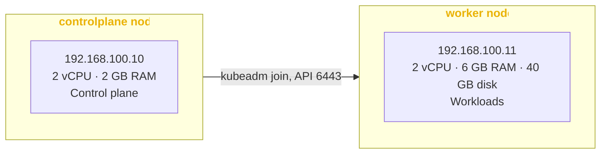

# MKube


Provision your local Kubeadm Kubernetes cluster with Vagrant and ansible.

MKube is Just like [Kontainer8](https://github.com/theJaxon/Kontainer8) but for Mac with Apple silicon chip (M1/2/3/4).

---

### Prerequisites
- [Virtualbox](https://www.virtualbox.org/wiki/Downloads)
- [Vagrant](https://developer.hashicorp.com/vagrant/install)

---

### How to use
```bash
# Clone the repo
git clone https://github.com/theJaxon/MKube.git

cd MKube

# Start the machines 
vagrant up

# SSH into any of the machines 
vagrant ssh < controlplane | worker >
```



---

### Building and releasing the box
The box is built from [theJaxon/Packer](https://github.com/theJaxon/Packer) (`Fedora/44`) and released on this repo's [GitHub Releases](https://github.com/theJaxon/MKube/releases); each release (`v<version>`) holds the box and the Vagrant catalog, and the Vagrantfile reads the catalog from the latest release.
The Packer build needs VirtualBox on Apple silicon, so it runs locally; linting and publishing go through [Dagger](https://dagger.io).

```bash
export GITHUB_TOKEN=...   # Contents: read & write on this repo
make release              # lint → build → publish → bump → smoke-test
```

Rebuilding the same Kubernetes version replaces that release's box. To pick up a rebuilt box locally, remove the cached one first:
```bash
vagrant box remove the-jaxon/mkube --box-version 1.37.1 --provider virtualbox
```

---

### Versions Used
- Vagrant V2.4.9
- Virtualbox 7.2.6
- Kubeadm 1.37.1
- Fedora **44**

---

### Helper Projects
1. [ContainerD](https://cri-o.io/) - Container Runtime
2. [Cilium](https://cilium.io/use-cases/cni/) - Container Network Interface
3. [Traefik](https://doc.traefik.io/traefik/providers/kubernetes-ingress/) - Ingress Controller
4. [Local Path Provisioner](https://github.com/rancher/local-path-provisioner) Dynamic provisioning (Used as default storage class)

---

### References
1. [Oracle VirtualBox 7.2 introduces support for macOS on Apple Silicon and Microsoft Windows for Arm](https://blogs.oracle.com/developers/oracle-virtualbox-72)
2. [Kubernetes cluster with Kubeadm on Fedora](https://docs.fedoraproject.org/en-US/quick-docs/using-kubernetes-kubeadm/)
3. [chef/bento Packer Templates](https://github.com/chef/bento)
